# Comparativas reales · Cierre A

Antes: ZONAS1 `ac9bedf`. Después: Cierre A. Chromium Linux, mismo texto FEP de 150 px, mismo color, escena Estudio y cámara Presentación. El encuadre automático de los nuevos modelos evita recortes. Son capturas del visor, sin retoque ni imágenes generadas.

| Producto | Antes | Después |
|---|---|---|
| Bolsa | 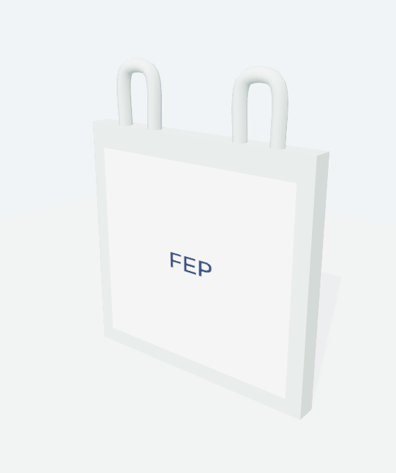 | 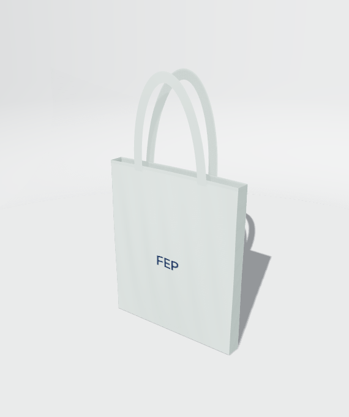 |
| Libreta | 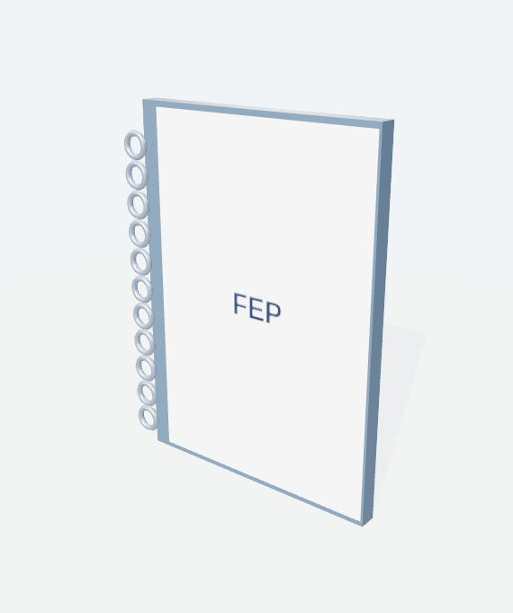 | 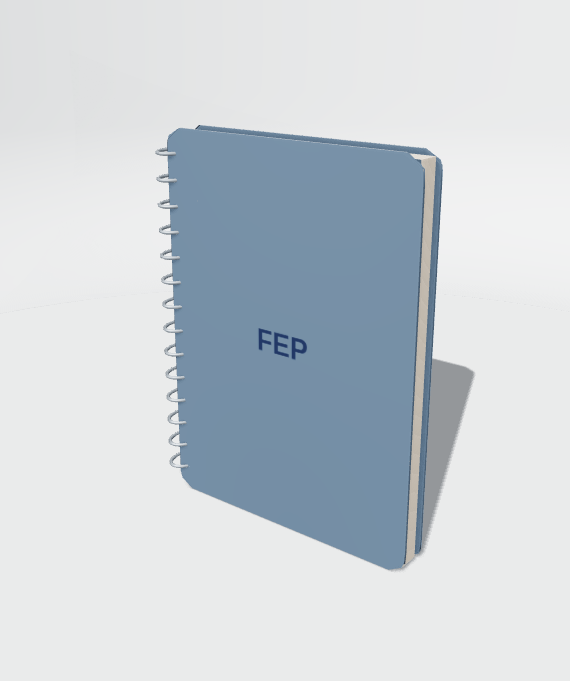 |
| Taza | 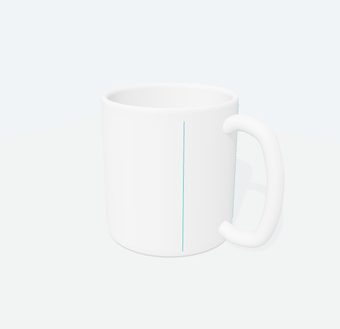 | 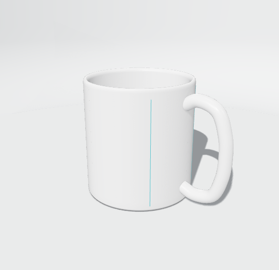 |
| Polera | 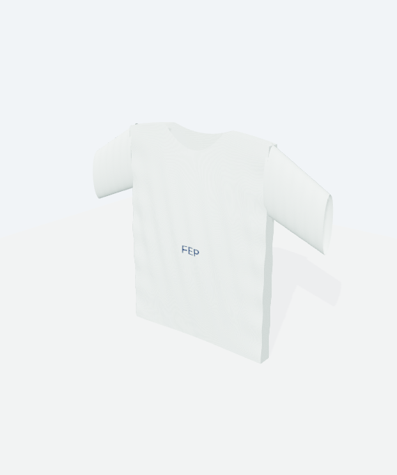 |  |
| Cojín | 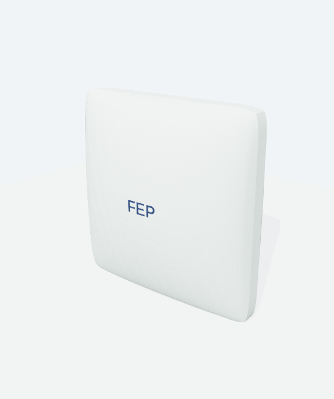 | 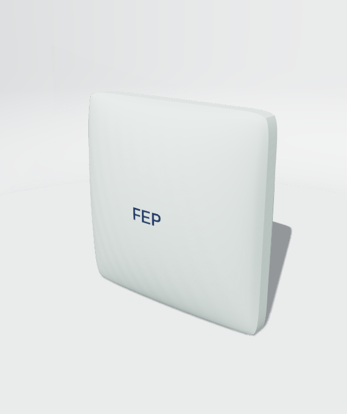 |

## Móvil emulado

| Producto | Antes | Después |
|---|---|---|
| Bolsa | 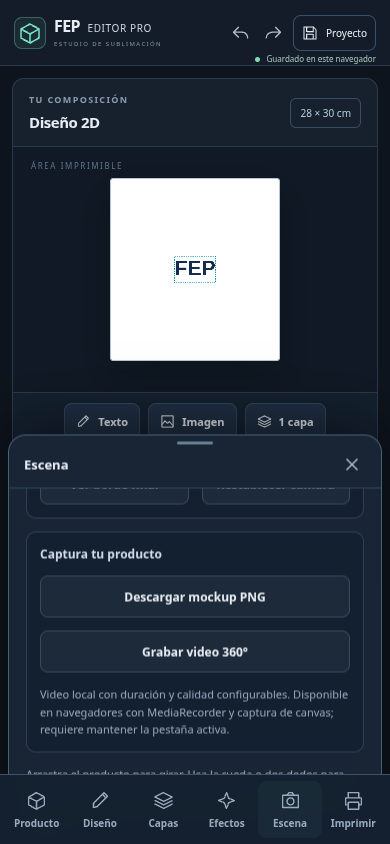 | 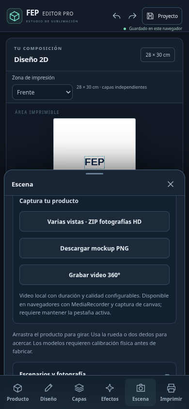 |
| Libreta | 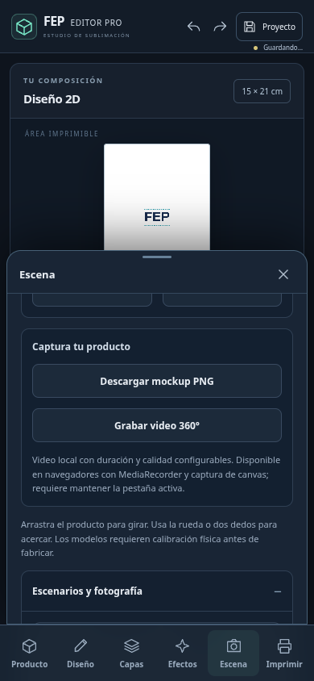 | 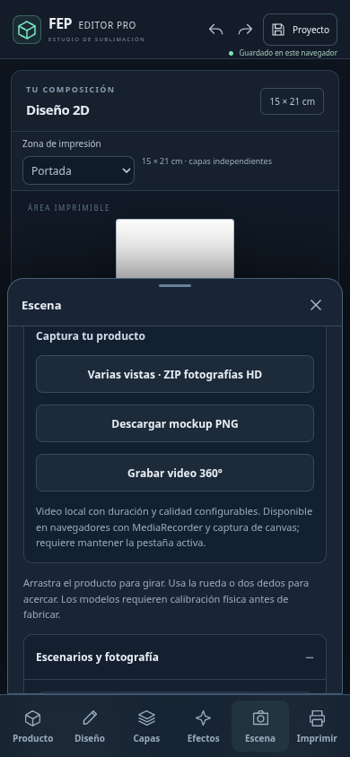 |

[Bolsa con imagen transparente](evidence/cierre-a/desktop-tote-floral.png) · [Libreta con imagen transparente](evidence/cierre-a/desktop-notebook-floral.png) · [Bolsa móvil](evidence/cierre-a/mobile-tote-floral.png) · [Libreta móvil](evidence/cierre-a/mobile-notebook-floral.png).

## Ocho escenas · fotografías HD del renderer

La cámara Zona impresa encuadra el arte sin modificar su posición de 270° ni el archivo de producción.

| Ambiente | Fotografía |
|---|---|
| Estudio | 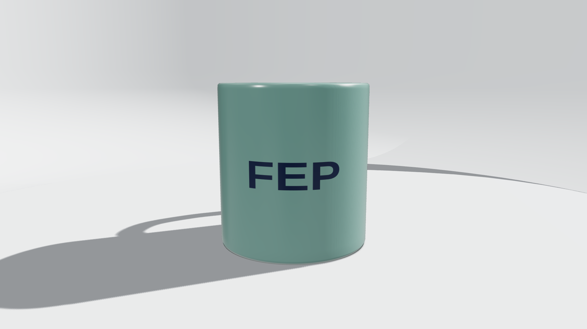 |
| Madera | 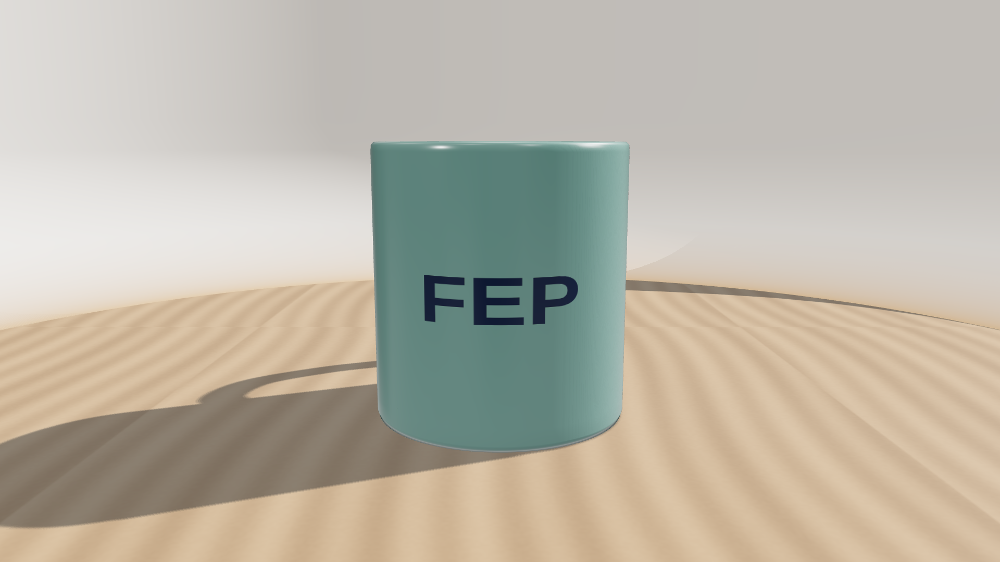 |
| Mármol | 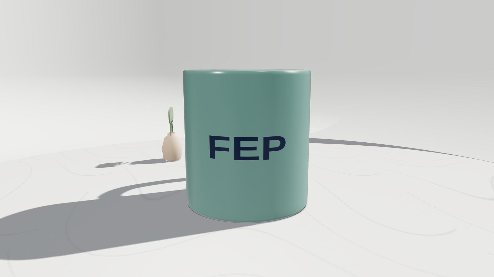 |
| Escritorio | 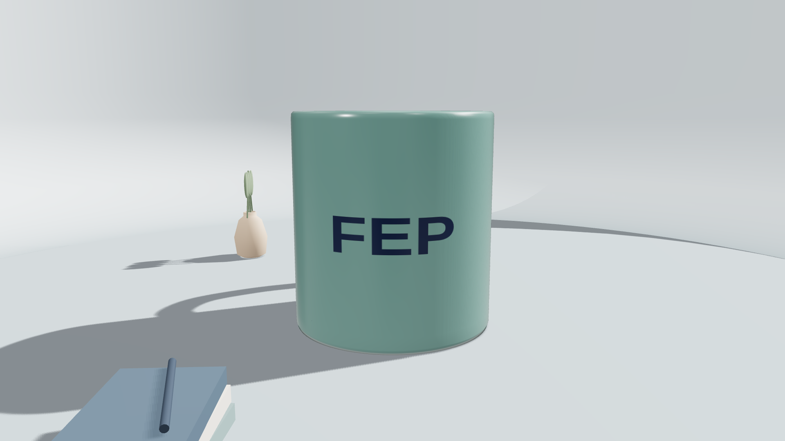 |
| Cafetería | 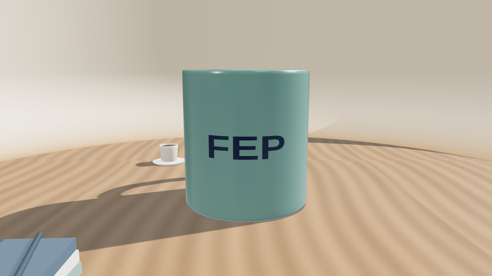 |
| Textil | 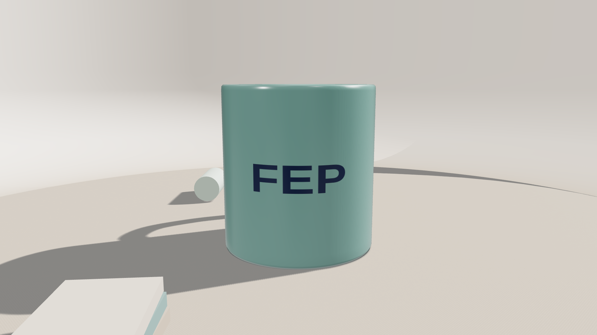 |
| Minimalista | 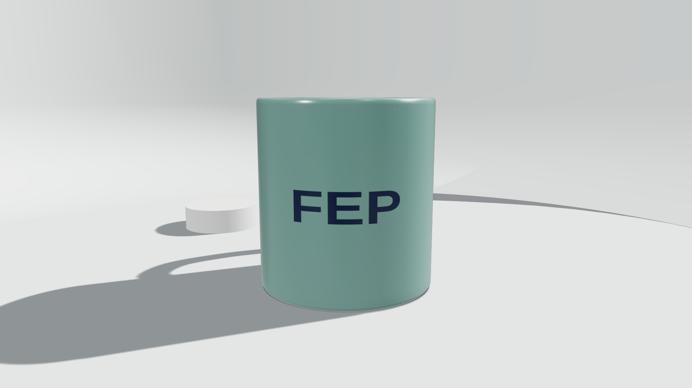 |
| Degradado | 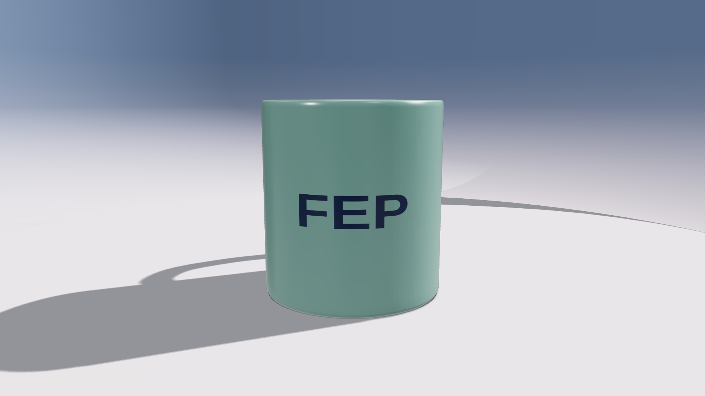 |

La perspectiva y las sombras proceden de geometría, luces y superficies 3D. Los PNG de producción permanecen idénticos entre escenas. Los ambientes son estilizados y originales; la calibración física comercial sigue pendiente.
