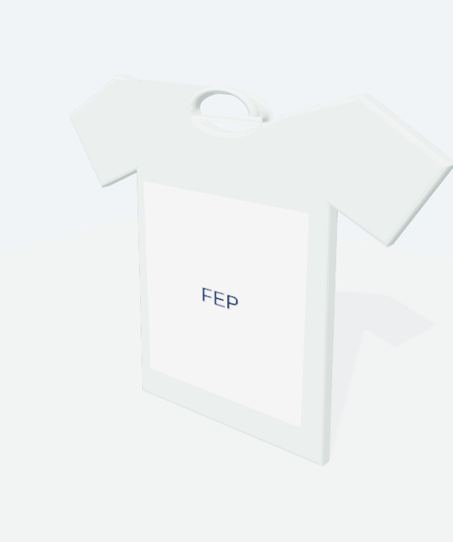
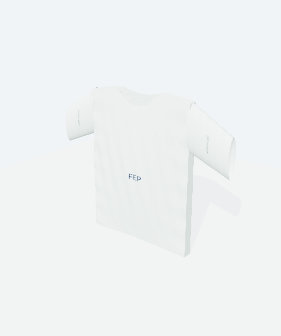
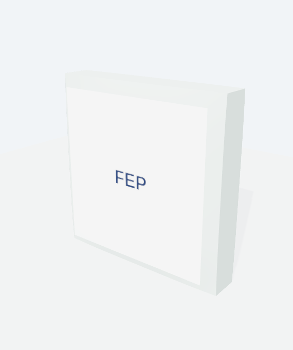
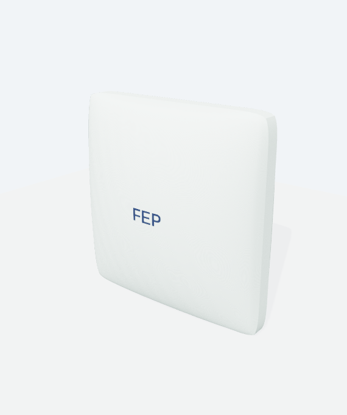
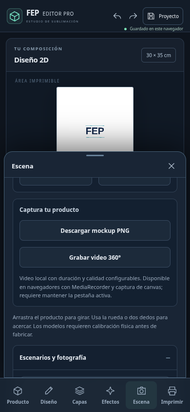
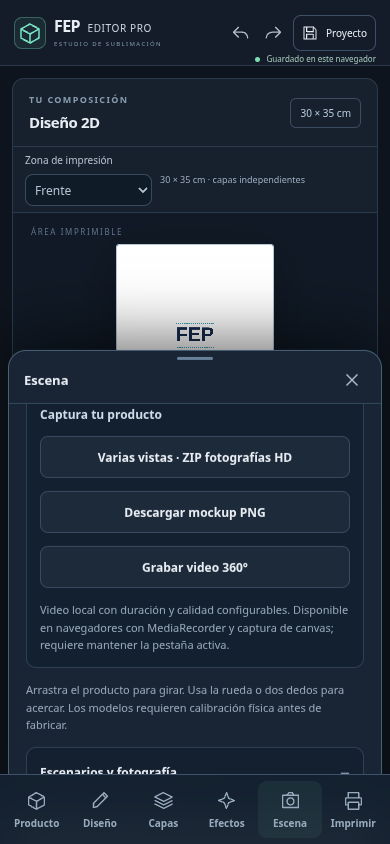
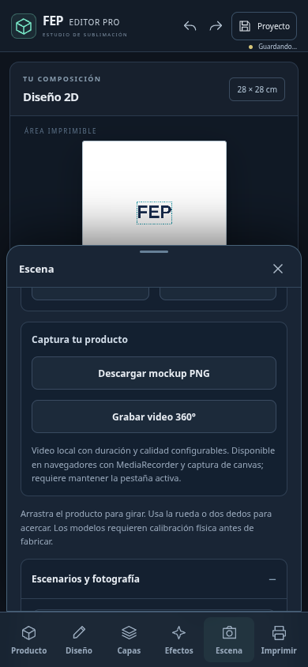
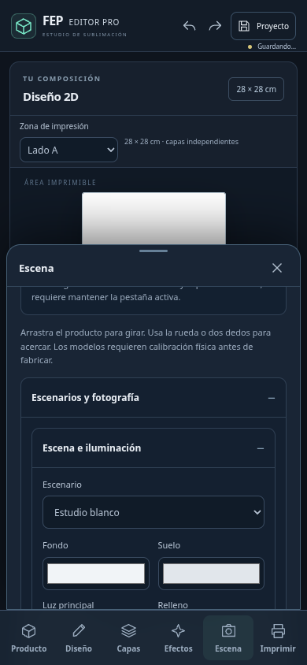

# Comparativa visual · primera entrega de zonas

Capturas reales de Chromium. Antes: commit `4b78e28` (3F). Después: esta entrega. Mismo texto FEP, color de producto `#c5d7cf`, escenario Estudio y cámara Presentación. El encuadre nuevo ajusta la distancia a la geometría para evitar recortes. No son imágenes generadas ni retoques del resultado.

## Polera · visor de escritorio

| Antes: extrusión y plano de impresión | Después: GLB curvo y tinta sobre tela |
|---|---|
|  |  |

## Cojín · visor de escritorio

| Antes: caja deformada y plano frontal | Después: caras acolchadas con UV independientes |
|---|---|
|  |  |

## Móvil emulado

| Producto | Antes | Después |
|---|---|---|
| Polera |  |  |
| Cojín |  |  |

## Transparencias y todas las caras

[Polera floral](evidence/zonas1/desktop-shirt-floral.png) · [Cojín floral](evidence/zonas1/desktop-cushion-floral.png) · [Móvil polera floral](evidence/zonas1/mobile-shirt-floral.png) · [Móvil cojín floral](evidence/zonas1/mobile-cushion-floral.png).

[Frente](evidence/zonas1/shirt-front-view.png) · [Espalda](evidence/zonas1/shirt-back-view.png) · [Manga izquierda](evidence/zonas1/shirt-leftSleeve-view.png) · [Manga derecha](evidence/zonas1/shirt-rightSleeve-view.png) · [Lado A](evidence/zonas1/cushion-a-view.png) · [Lado B](evidence/zonas1/cushion-b-view.png).

La prueba floral mide los píxeles del mapa aplicado a la malla: las zonas transparentes mantienen el color de tela, incluso dentro del rectángulo imprimible, y la tinta modifica solo su contenido. Cada superficie tiene normales y curvatura reales. Las caras posteriores invierten el eje U de la geometría, por lo que el texto se lee correctamente desde fuera; el espejo de producción es independiente del visor.

Estas mejoras son una referencia digital paramétrica; no equivalen a un escaneo de una prenda fabricada ni a una calibración comercial de tela, talla o color. Los modelos y la flor de prueba son originales. Los escenarios ampliados de la tercera entrega aún no se incorporan.
